# 3D3D Free Tools

Free tools for design, files and 3D printing, and a 40-lesson 3D printing academy. Everything
runs in the browser tab: no account, no watermark, no trial and no upload. English and French.

[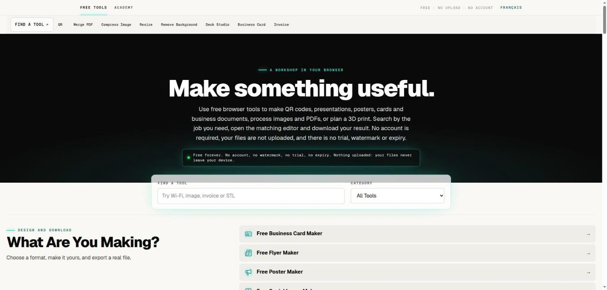](app/growth-lab/tools/hub/)

- **36 tools**: QR codes, business cards, flyers, posters, pitch decks, invoices, image and PDF
  utilities, a background remover, a 3D model viewer and printing calculators.
- **A 40-lesson academy**: original diagrams, sources, a glossary and progress saved on your device.
- **A static site**: `npm run build` writes plain HTML, JavaScript and files. Any static host works.
- **Works on a phone**: the editors switch to a controls/preview layout at narrow widths.
- **Apache-2.0**, with every dependency's licence listed in [`THIRD-PARTY-LICENSES.md`](THIRD-PARTY-LICENSES.md).

The tools are made by [3D3D](https://3d3d.ca), who also print, model and build things to order.
They run on 3d3d.ca at [/tools](https://3d3d.ca/tools); this repository is the same code, buildable
and runnable on its own.

<p>
  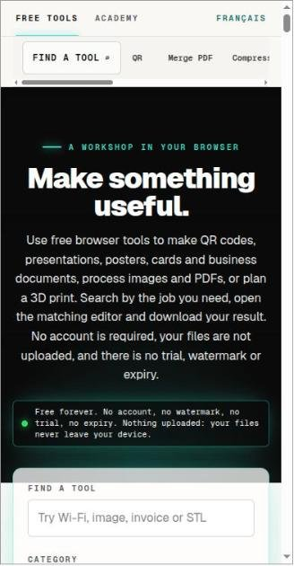
  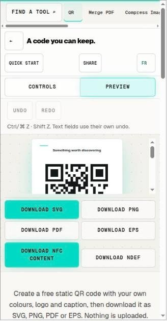
</p>

## The tools

Each row links to the tool's folder, which has its own short README: what it does, how to use it,
and where its code is.

<!-- tools:start -->
| Screenshot | Tool |
| --- | --- |
| <a href="app/growth-lab/tools/business-card/"></a> | **[Free Business Card Maker](app/growth-lab/tools/business-card/)**<br>Design two faces, add a contact QR and prepare a measured print PDF. |
| <a href="app/growth-lab/tools/calendar-qr-code/"></a> | **[Free Calendar Event QR Generator](app/growth-lab/tools/calendar-qr-code/)**<br>Encode a local event record and verify the imported calendar time. |
| <a href="app/growth-lab/tools/compress-image/"></a> | **[Free Image Compressor](app/growth-lab/tools/compress-image/)**<br>Compare real bytes and visible quality before keeping a compressed image. |
| <a href="app/growth-lab/tools/convert-image/"></a> | **[Free Image Converter](app/growth-lab/tools/convert-image/)**<br>Create a genuinely encoded image in the format your next application needs. |
| <a href="app/growth-lab/tools/crop-image/">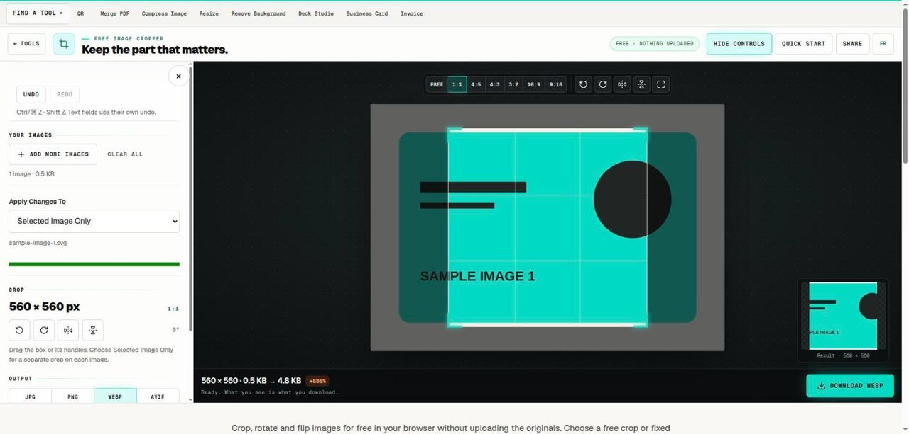</a> | **[Free Image Cropper](app/growth-lab/tools/crop-image/)**<br>Choose the composition, proportions and orientation before exporting a new image. |
| <a href="app/growth-lab/tools/favicon-generator/">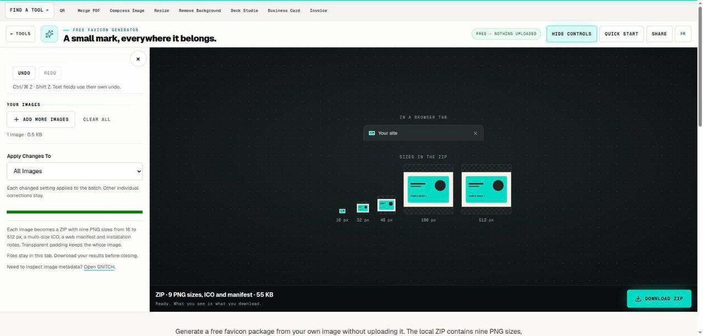</a> | **[Free Favicon Generator](app/growth-lab/tools/favicon-generator/)**<br>Package a master image into icon files and a starter web manifest. |
| <a href="app/growth-lab/tools/filament-calculator/">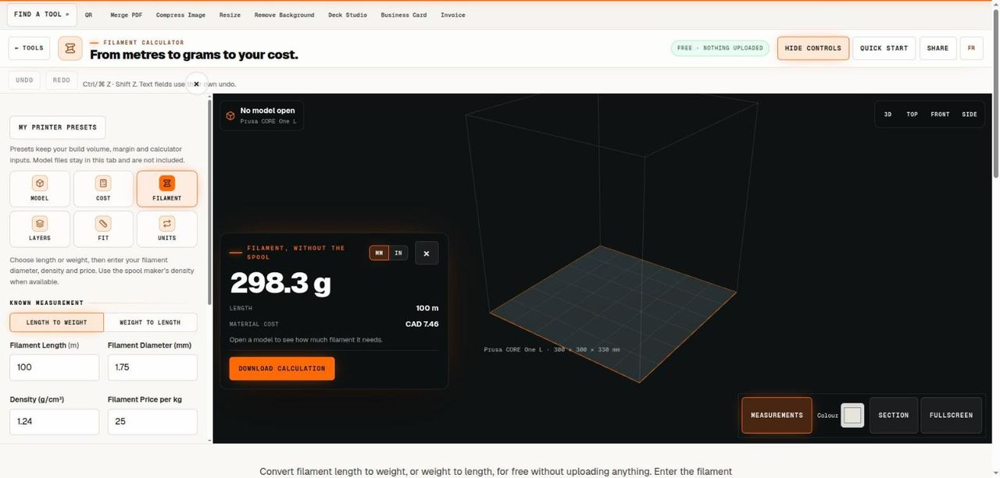</a> | **[Filament Calculator](app/growth-lab/tools/filament-calculator/)**<br>Relate filament length and mass using the actual diameter and density. |
| <a href="app/growth-lab/tools/flyer-maker/">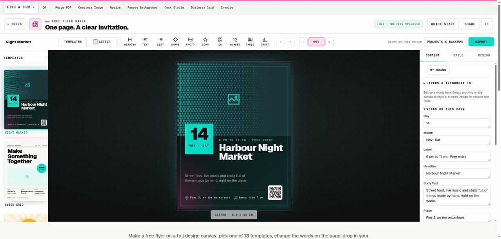</a> | **[Free Flyer Maker](app/growth-lab/tools/flyer-maker/)**<br>Design a handout on a canvas with your words, photos and a QR code. |
| <a href="app/growth-lab/tools/heic-to-jpg/">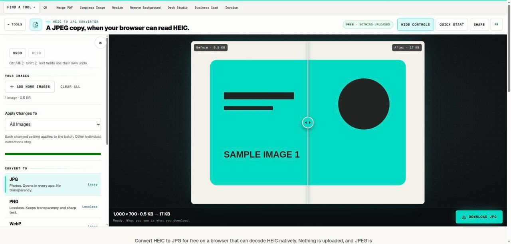</a> | **[HEIC to JPG Converter](app/growth-lab/tools/heic-to-jpg/)**<br>Use native HEIC decoding to make ordinary JPEG delivery copies. |
| <a href="app/growth-lab/tools/images-to-pdf/"></a> | **[Images to PDF](app/growth-lab/tools/images-to-pdf/)**<br>Package supported images as a single PDF with deliberate page sizing. |
| <a href="app/growth-lab/tools/invoice-generator/">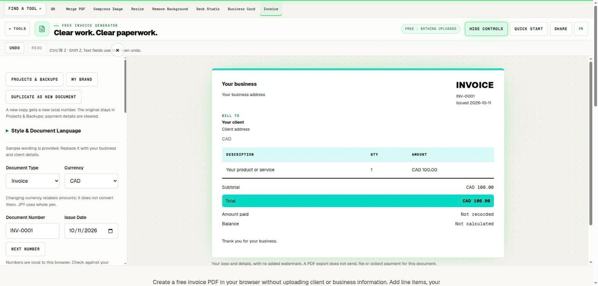</a> | **[Free Invoice Generator](app/growth-lab/tools/invoice-generator/)**<br>Prepare an invoice using your own business details and agreed prices. |
| <a href="app/growth-lab/tools/jpg-to-pdf/">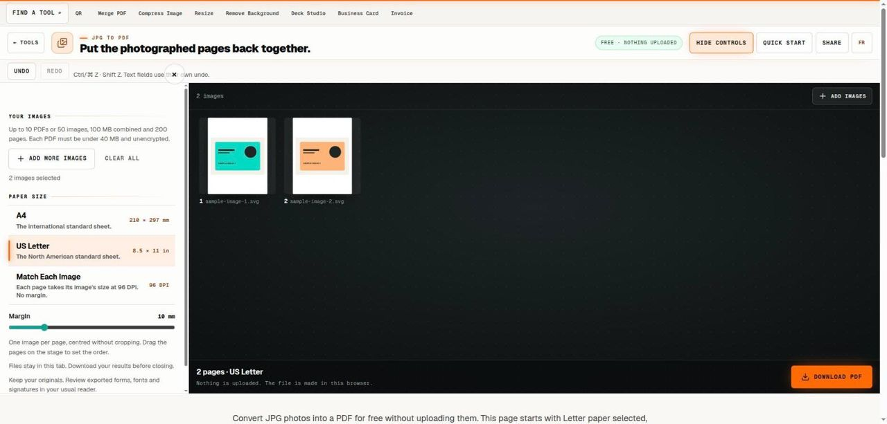</a> | **[JPG to PDF](app/growth-lab/tools/jpg-to-pdf/)**<br>Make a Letter-size document from JPEG photos or scans. |
| <a href="app/growth-lab/tools/merge-pdf/"></a> | **[Merge PDF Files](app/growth-lab/tools/merge-pdf/)**<br>Combine a set of PDFs and review the page sequence before export. |
| <a href="app/growth-lab/tools/model-viewer/"></a> | **[STL, OBJ and 3MF Viewer](app/growth-lab/tools/model-viewer/)**<br>Inspect a mesh, check its scale and keep a measurement report. |
| <a href="app/growth-lab/tools/nozzle-layer-guide/"></a> | **[Nozzle and Layer Height Guide](app/growth-lab/tools/nozzle-layer-guide/)**<br>Compare a proposed layer height with the nozzle diameter and profile guidance. |
| <a href="app/growth-lab/tools/organize-pdf/"></a> | **[Organize PDF Pages](app/growth-lab/tools/organize-pdf/)**<br>Correct the order and orientation of an existing PDF package. |
| <a href="app/growth-lab/tools/pdf-to-image/"></a> | **[PDF Pages to Images](app/growth-lab/tools/pdf-to-image/)**<br>Choose a raster format and resolution for selected PDF pages. |
| <a href="app/growth-lab/tools/pdf-to-jpg/">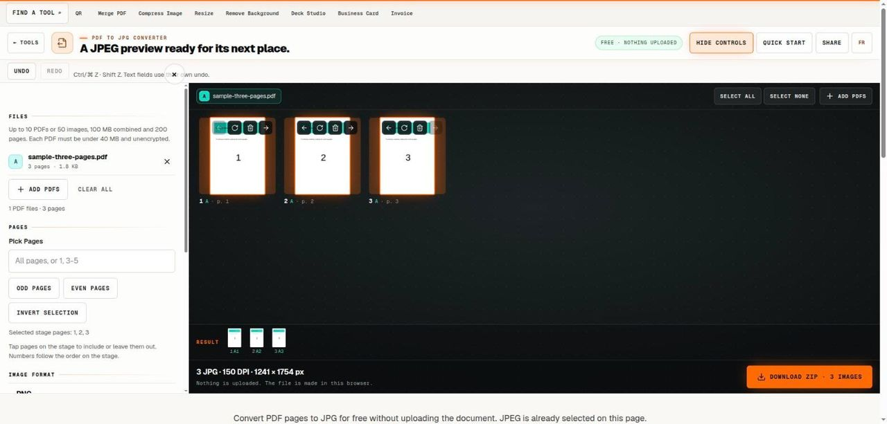</a> | **[PDF to JPG Converter](app/growth-lab/tools/pdf-to-jpg/)**<br>Render PDF pages as ordinary JPEG images for compatible destinations. |
| <a href="app/growth-lab/tools/pitch-deck/">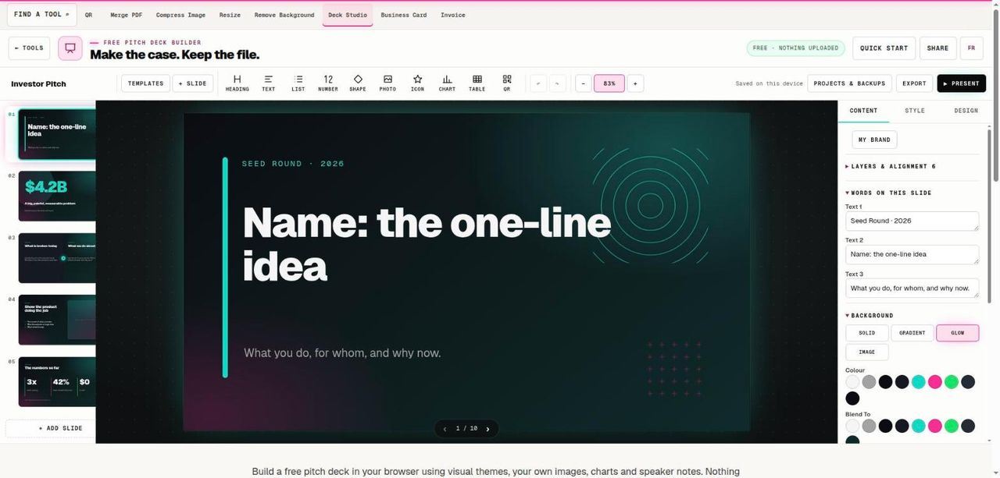</a> | **[Free Pitch Deck Builder](app/growth-lab/tools/pitch-deck/)**<br>Arrange a presentation with charts, images, notes and editable exports. |
| <a href="app/growth-lab/tools/png-to-webp/">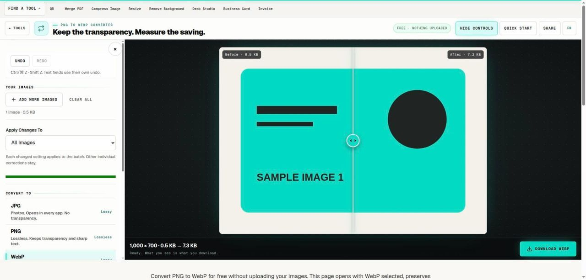</a> | **[PNG to WebP Converter](app/growth-lab/tools/png-to-webp/)**<br>Create WebP copies of PNG images and compare the actual bytes. |
| <a href="app/growth-lab/tools/poster-maker/">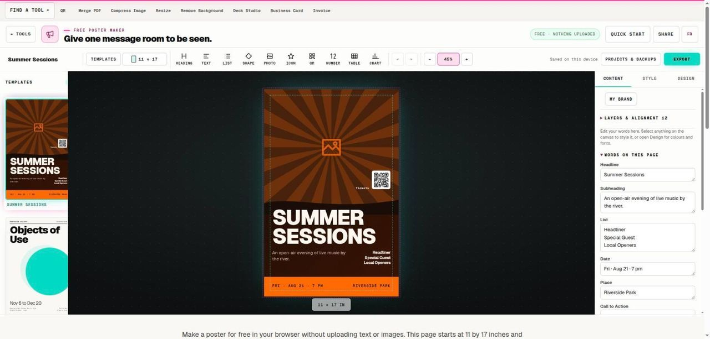</a> | **[Free Poster Maker](app/growth-lab/tools/poster-maker/)**<br>Create a large-format notice with a deliberate hierarchy and print export. |
| <a href="app/growth-lab/tools/print-cost-calculator/">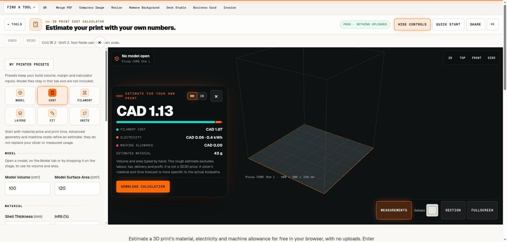</a> | **[3D Print Cost Calculator](app/growth-lab/tools/print-cost-calculator/)**<br>Compare material, electricity and machine allowance before a print. |
| <a href="app/growth-lab/tools/qr-code/">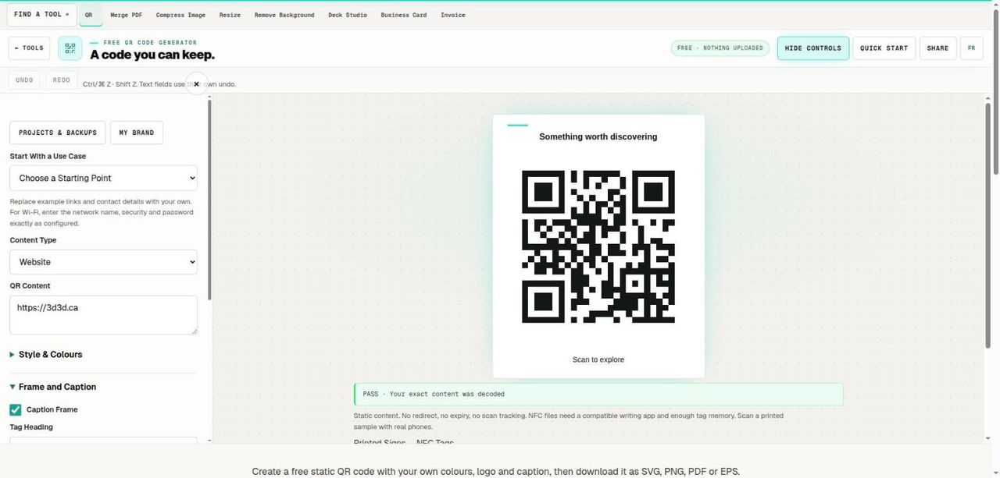</a> | **[Free QR Code Generator](app/growth-lab/tools/qr-code/)**<br>Style and verify static codes for links, contacts, networks and events. |
| <a href="app/growth-lab/tools/quote-generator/">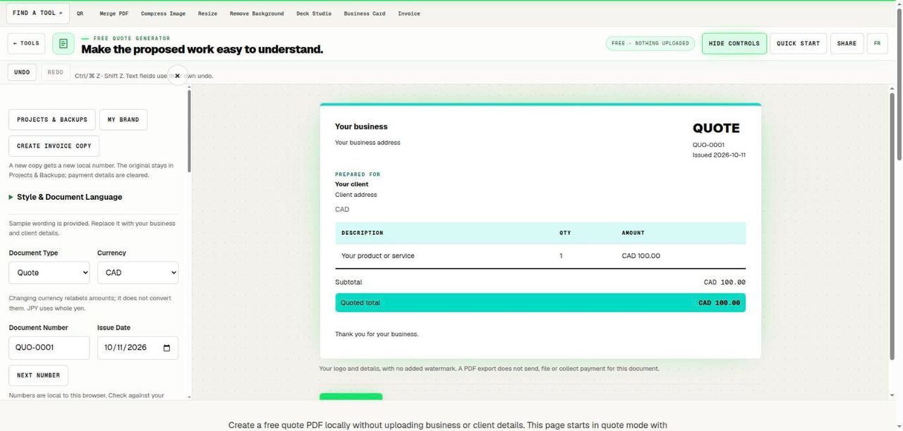</a> | **[Free Quote Generator](app/growth-lab/tools/quote-generator/)**<br>Describe the scope and prices before the job begins. |
| <a href="app/growth-lab/tools/receipt-generator/">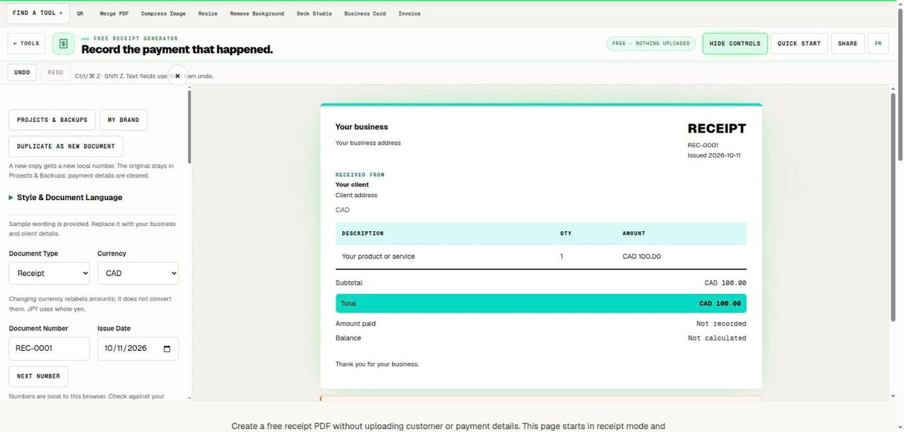</a> | **[Free Receipt Generator](app/growth-lab/tools/receipt-generator/)**<br>Prepare a receipt with an actual payment amount, date and method. |
| <a href="app/growth-lab/tools/remove-background/">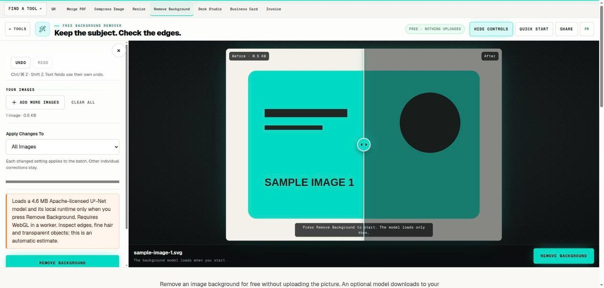</a> | **[Free Background Remover](app/growth-lab/tools/remove-background/)**<br>Estimate a foreground mask locally and export a transparent PNG. |
| <a href="app/growth-lab/tools/resize-image/"></a> | **[Free Image Resizer](app/growth-lab/tools/resize-image/)**<br>Set pixel bounds or a percentage, with an explicit contain or cover choice. |
| <a href="app/growth-lab/tools/rounded-image/"></a> | **[Round Image Corners](app/growth-lab/tools/rounded-image/)**<br>Round corners and add a border without changing the image dimensions. |
| <a href="app/growth-lab/tools/social-image-maker/">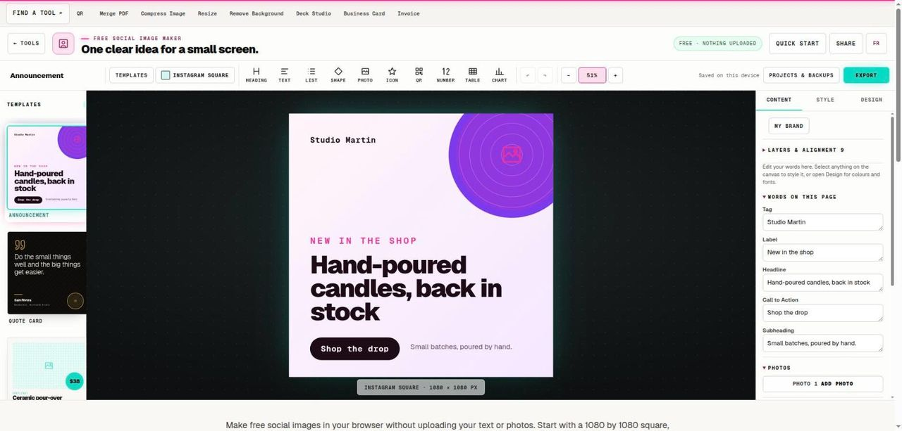</a> | **[Free Social Image Maker](app/growth-lab/tools/social-image-maker/)**<br>Prepare social graphics in useful pixel formats and keep the files. |
| <a href="app/growth-lab/tools/split-pdf/">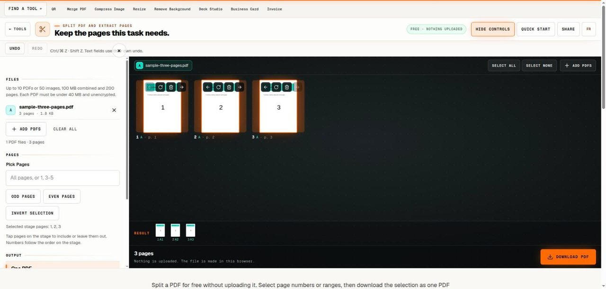</a> | **[Split PDF and Extract Pages](app/growth-lab/tools/split-pdf/)**<br>Select pages, export an excerpt or separate them into individual PDFs. |
| <a href="app/growth-lab/tools/stamp-pdf/">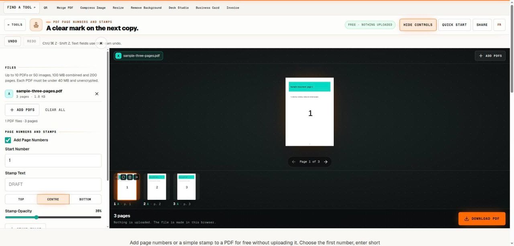</a> | **[PDF Page Numbers and Stamps](app/growth-lab/tools/stamp-pdf/)**<br>Add sequence numbers or a visible text or image mark to PDF pages. |
| <a href="app/growth-lab/tools/svg-to-png/">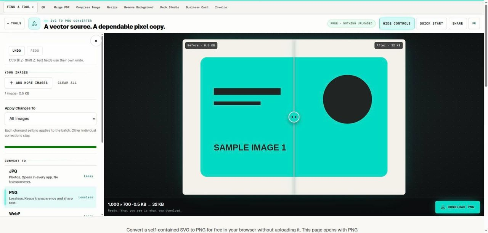</a> | **[SVG to PNG Converter](app/growth-lab/tools/svg-to-png/)**<br>Render supported SVG artwork into a transparent PNG on your device. |
| <a href="app/growth-lab/tools/tolerance-calculator/">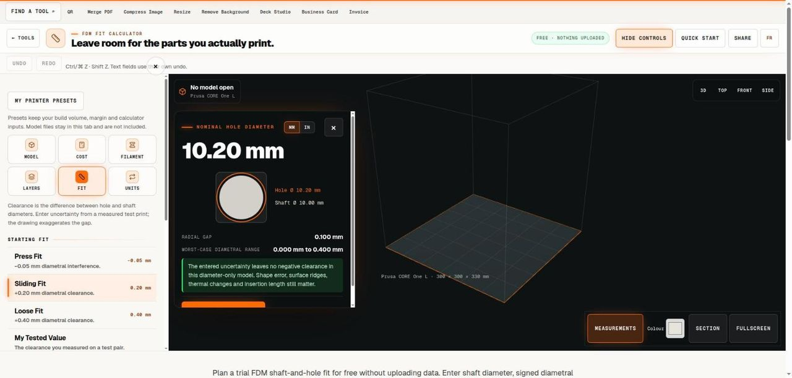</a> | **[FDM Fit Calculator](app/growth-lab/tools/tolerance-calculator/)**<br>Compare nominal fit and a simple worst-case clearance interval. |
| <a href="app/growth-lab/tools/unit-converter/"></a> | **[3D Printing Unit Converter](app/growth-lab/tools/unit-converter/)**<br>Convert compatible quantities without confusing length, volume and mass. |
| <a href="app/growth-lab/tools/vcard-qr-code/">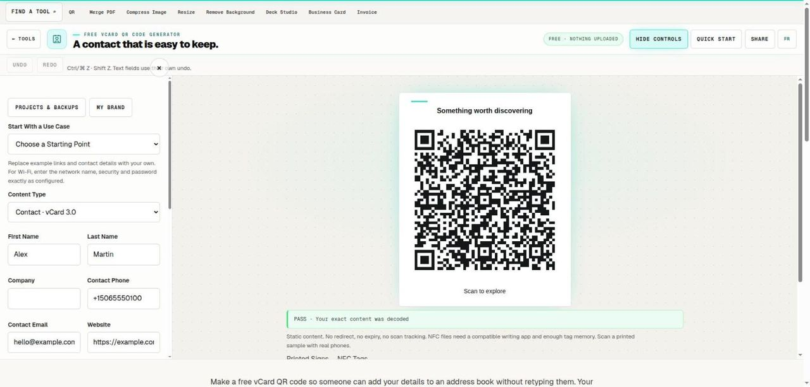</a> | **[Free vCard QR Code Generator](app/growth-lab/tools/vcard-qr-code/)**<br>Put a concise contact record directly in a code for address-book import. |
| <a href="app/growth-lab/tools/wifi-qr-code/"></a> | **[Free Wi-Fi QR Code Generator](app/growth-lab/tools/wifi-qr-code/)**<br>Make a readable guest-network sign with the exact connection details. |
<!-- tools:end -->

## Run it

You need Node.js 22 or newer.

```bash
npm ci
npm run dev        # http://localhost:5190, with hot reload
```

## Build it

```bash
npm run build      # writes build/client: 170 HTML pages and their assets
npm run preview    # serves build/client at http://127.0.0.1:4190, as a static host would
```

`build/client` is the whole site. Every page is rendered to HTML at build time and then hydrates in the
browser, so there is no server to run.

### Host it

Copy `build/client` to any static host (GitHub Pages, Cloudflare Pages, Netlify, an S3 bucket, nginx).

- Serve it from the root of a domain. The tools fetch `/pdf-assets/`, `/models/` and `/academy/` by
  absolute path.
- `/tools/qr-code` must resolve to `tools/qr-code/index.html`, which is the default on static hosts.
- `404.html` is the not-found page. There is no single-page-app fallback to configure.

## How your files stay on your device

A tool reads a file you give it in the page, works on it with browser APIs and WebAssembly, and offers
the result as a download. There is no upload path in the code. That is checked, not only stated:
`tests/network-surface.test.mjs` lists every place the code can make a network request, with the reason
it is allowed, and fails if a new one appears.

What can reach the network, in full:

| Request | When | To |
| --- | --- | --- |
| The page, its scripts, styles and fonts | You open it | The host you served it from |
| `public/pdf-assets/*` | A PDF tool draws a page | The same host |
| `public/models/u2netp-webgl.onnx` (4.4 MB) | You press **Remove Background** | The same host |
| Lesson diagrams | A lesson is open | The same host |
| Feedback and lesson-correction forms | You press **Send**, and only if `VITE_FEEDBACK_ENDPOINT` is set | The endpoint you configure |
| Cloudflare Turnstile script | You press **Verify**, and only if `VITE_TURNSTILE_SITE_KEY` is set | challenges.cloudflare.com |
| Share menu | You pick a network | An ordinary link that opens in a new tab |

Nothing is counted: the analytics hook the 3D3D site uses is a no-op here (`app/lib/analytics.ts`).
Drafts, projects and brand details are kept in your browser's local storage, on your device.

## Configure it

Nothing is required. Copy `.env.example` to `.env` to change anything.

| Variable | Default | Effect |
| --- | --- | --- |
| `VITE_FEEDBACK_ENDPOINT` | empty | Where the Feedback form and the lesson correction form post. Empty hides both forms and sends nothing. |
| `VITE_TURNSTILE_SITE_KEY` | empty | A Cloudflare Turnstile site key, for an endpoint that verifies a human check. Empty skips the check. |

The endpoint receives one `multipart/form-data` POST with a `payload` field (JSON) and must reply
`{ "ref": "<receipt>" }`. The form shows the receipt to the visitor.

## What is where

```
app/
  growth-lab/        the tools and the academy (synced from the 3D3D site, see below)
    tools/<tool>/    one folder per tool, each with a README
    academy/         the 40 lessons, glossary, sources and progress
    shared/          the editor kit: stages, projects, brand, file handling, styles
    seo/             tool guides (English and French), catalogue, page metadata
  content/           the page the tools sit in (header-less shell, skip link, footer)
  lib/               the seam to the host: feedback endpoint, links, analytics no-op
  ui/                the optional human-check widget
  routes.ts          tools hub at /, plus app/growth-lab's routes
public/              files the tools fetch: PDF.js assets, the background model, lesson diagrams
tests/               npm test
scripts/             prerender list, static server, secret scan, licence inventory
```

## Where the code comes from

The tools are developed in the 3D3D site's own repository and copied here, so the site and this
repository do not drift. `app/growth-lab/`, the tests copied into `tests/`, and the files in `public/`
that the tools fetch are written by that copy (`SYNC.json` records which commit). Edit them here for a
pull request and a maintainer applies the change at the source; the next copy brings it back. The files
around them (`app/root.tsx`, `app/routes.ts`, `app/content/`, `app/lib/`, `app/ui/`, the scripts, this
README) belong to this repository.

The copy removes what only means something on the 3D3D site: its discovery listing, its server-side
intake handler, its content-security policy and internal planning notes.

## Check it

```bash
npm run typecheck        # React Router typegen, then tsc
npm test                 # 7 test files, run one process each
npm run scan             # secret and personal-data scan of everything published
npm run licenses:check   # fails if a production dependency is outside the permissive list
```

What the tests cover: import safety (a hostile file or saved draft is refused), the design studios
(every template at every size, in both languages), the hub and its previews, language of untouched
sample content, tool search, the network surface, and that the forms and analytics are off by default.

## Licence

Apache-2.0, see [`LICENSE`](LICENSE) and [`NOTICE`](NOTICE). Third-party code and assets keep their own
licences, listed in [`THIRD-PARTY-LICENSES.md`](THIRD-PARTY-LICENSES.md).

The 3D3D name and logo are not covered by the licence.

## Contributing

The lessons are the part that most wants help. If a lesson is wrong, out of date, unclear or missing
something you learned the hard way at the printer, open a pull request against its file in
`app/growth-lab/academy/lessons/` (French in `academy/fr/`) or an issue with the passage and the fix. Tool fixes and French wording are just
as welcome.

See [`CONTRIBUTING.md`](CONTRIBUTING.md). To report a security problem, see [`SECURITY.md`](SECURITY.md).
