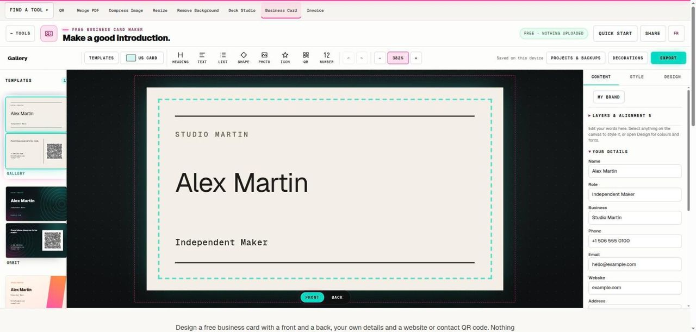

# Free Business Card Maker

> Design two faces, add a contact QR and prepare a measured print PDF.

## What it does

Design a free business card with a front and a back, your own details and a website or contact QR code. Nothing is uploaded. Choose US or European dimensions, pick one of 17 styles, and download a two-page print PDF with bleed and crop marks or a sheet of ten cards with cut marks. Check a printed sample before ordering a full set.

## How to use it

1. Choose 3.5 by 2 inches or 85 by 55 millimetres before adding content. Select one of the 17 templates and decide what belongs on the front and what the back should help the recipient do.
2. Enter the name, role, business and useful contact details once; they fill both sides of every template. Drop in a logo or photo where you want it. Prefer one dependable contact channel over a crowded list of services, social handles and numbers that will soon become outdated.
3. Choose whether the QR code holds your website or your contact card, then check both sides. The export panel warns when words sit outside the safe line or the code is too small or too pale to scan.
4. Export the print PDF and verify that it contains two pages in the right order, or the 10-up sheet for a home or copy-shop printer. Confirm the trim, bleed, duplex orientation and crop-mark requirements with the printer, then approve a physical proof after testing the QR.

## In this repository

- Route: `/tools/business-card` and `/fr/tools/business-card` (French). The page is `route.tsx` / `route.fr.tsx` in this folder.
- The editor is in [`../design-studio/`](../design-studio/), shared with: `flyer-maker`, `poster-maker`, `social-image-maker`.
- Guide text: [`../../seo/content/business-card.en.ts`](../../seo/content/business-card.en.ts) and `business-card.fr.ts`.

## Your files

The tool runs in the page. A file you open is read by the browser and processed on your device; the code in this repository has no upload path for it. `npm test` checks that every network call in the tools is on a short reviewed list (`tests/network-surface.test.mjs`).
