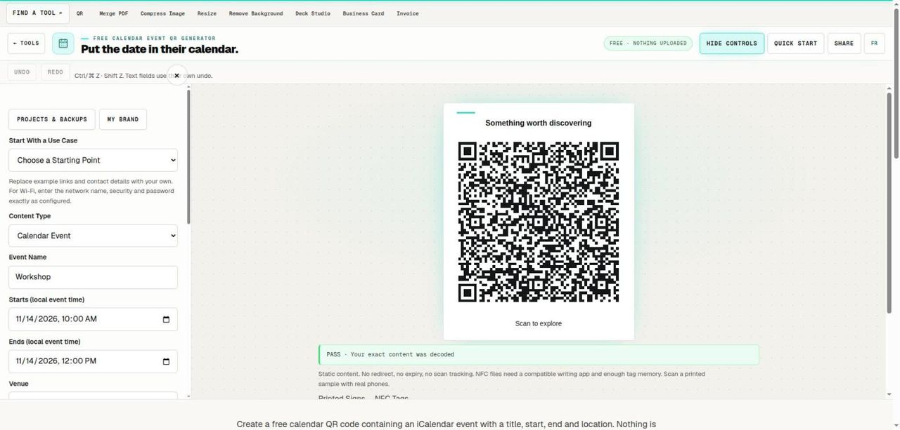

# Free Calendar Event QR Generator

> Encode a local event record and verify the imported calendar time.

## What it does

Create a free calendar QR code containing an iCalendar event with a title, start, end and location. Nothing is uploaded or hosted. Times use the event’s local clock, without an embedded time zone. Scan the result and verify the imported calendar time before sharing it with attendees.

## How to use it

1. Name the event and enter its location. Use the local clock time at the venue and state the time zone in the description, especially for remote attendees.
2. Set the local start and end in the editor. Review the encoded VEVENT and resolve any validation or scan error before downloading.
3. Import a scan into a test calendar and verify its local display. Keep a readable date, time zone and venue beside the QR on the invitation.

## In this repository

- Route: `/tools/calendar-qr-code` and `/fr/tools/calendar-qr-code` (French). The page is `route.tsx` / `route.fr.tsx` in this folder.
- The editor is in [`../qr-code/`](../qr-code/), shared with: `qr-code`, `vcard-qr-code`, `wifi-qr-code`.
- Guide text: [`../../seo/content/calendar-qr-code.en.ts`](../../seo/content/calendar-qr-code.en.ts) and `calendar-qr-code.fr.ts`.

## Your files

The tool runs in the page. A file you open is read by the browser and processed on your device; the code in this repository has no upload path for it. `npm test` checks that every network call in the tools is on a short reviewed list (`tests/network-surface.test.mjs`).
