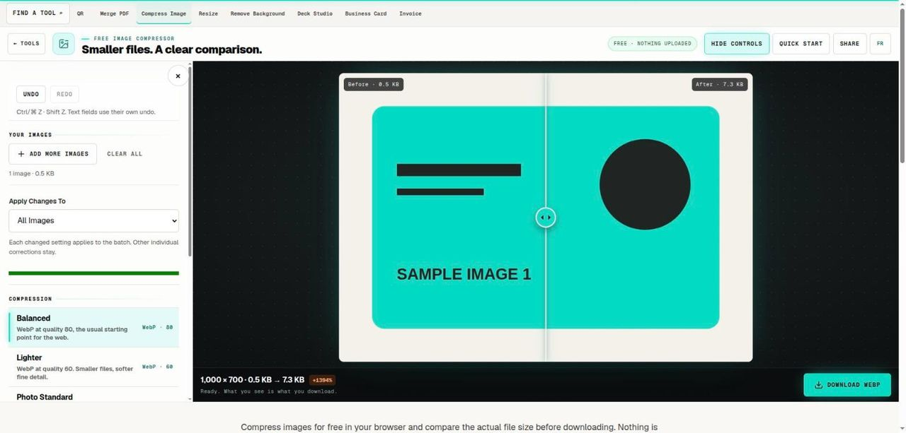

# Free Image Compressor

> Compare real bytes and visible quality before keeping a compressed image.

## What it does

Compress images for free in your browser and compare the actual file size before downloading. Nothing is uploaded. Choose JPG, PNG, WebP or AVIF, adjust quality where the format supports it, and process a batch locally. Keep the original and inspect fine details because a smaller file can lose visible information.

## How to use it

1. Choose a representative image or a batch of up to 20 files. Keep the total below 100 MB, each file below 40 MB and each image within 24 megapixels. Start with one image when trying an unfamiliar format.
2. Select an output format suited to the destination. Use the quality slider for JPG, WebP or AVIF. PNG optimization keeps the rendered pixels lossless; its file size is not controlled by the lossy-quality slider.
3. Run the batch and compare the reported input and output bytes. A larger result is labelled as larger. Inspect text, thin lines, gradients, faces and transparent edges at the size people will actually view.
4. Download individual results or the batch ZIP. Open a downloaded file in the destination application before replacing an existing asset. Keep the original master so future revisions do not start from an already compressed copy.

## In this repository

- Route: `/tools/compress-image` and `/fr/tools/compress-image` (French). The page is `route.tsx` / `route.fr.tsx` in this folder.
- The editor is in [`../image-toolkit/`](../image-toolkit/), shared with: `convert-image`, `crop-image`, `favicon-generator`, `heic-to-jpg`, `png-to-webp`, `remove-background`, `resize-image`, `rounded-image`, `svg-to-png`.
- Guide text: [`../../seo/content/compress-image.en.ts`](../../seo/content/compress-image.en.ts) and `compress-image.fr.ts`.

## Your files

The tool runs in the page. A file you open is read by the browser and processed on your device; the code in this repository has no upload path for it. `npm test` checks that every network call in the tools is on a short reviewed list (`tests/network-surface.test.mjs`).
