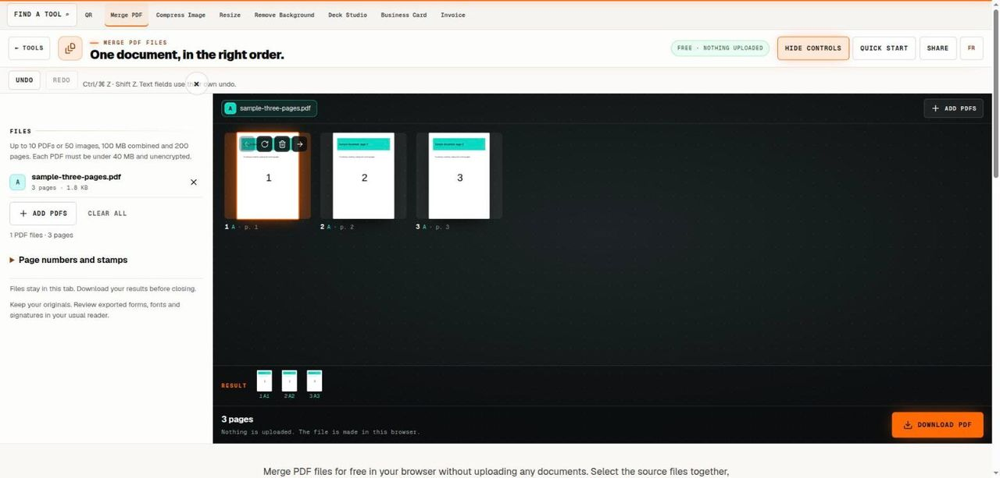

# Merge PDF Files

> Combine a set of PDFs and review the page sequence before export.

## What it does

Merge PDF files for free in your browser without uploading any documents. Select the source files together, review their pages, arrange the sequence and download a new combined PDF. The originals stay unchanged. This is a page assembly tool, so inspect forms, links, fonts and any special document features in your usual reader afterward.

## How to use it

1. Choose the PDFs that belong in the final package. Select the full group together, within ten files, 100 MB combined and 200 pages. Each file must be below 40 MB and readable without a password.
2. Review the page thumbnails in order. Put the introduction before its attachments and keep related pages together. Use drag and drop or the movement buttons to correct the sequence, and rotate any page that is facing the wrong direction.
3. Remove unwanted duplicates or separator pages only after identifying them. Undo can restore a local page edit while the session remains available. Keep at least one page and check the selected output sequence before downloading.
4. Download the combined PDF, then open that actual file in a reader. Count the pages, inspect the joins between source documents and check a few pages from each source. Give the result a meaningful filename and keep the originals separately.

## In this repository

- Route: `/tools/merge-pdf` and `/fr/tools/merge-pdf` (French). The page is `route.tsx` / `route.fr.tsx` in this folder.
- The editor is in [`../pdf-toolkit/`](../pdf-toolkit/), shared with: `images-to-pdf`, `jpg-to-pdf`, `organize-pdf`, `pdf-to-image`, `pdf-to-jpg`, `split-pdf`, `stamp-pdf`.
- Guide text: [`../../seo/content/merge-pdf.en.ts`](../../seo/content/merge-pdf.en.ts) and `merge-pdf.fr.ts`.

## Your files

The tool runs in the page. A file you open is read by the browser and processed on your device; the code in this repository has no upload path for it. `npm test` checks that every network call in the tools is on a short reviewed list (`tests/network-surface.test.mjs`).
