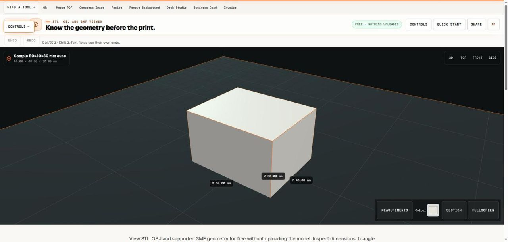

# STL, OBJ and 3MF Viewer

> Inspect a mesh, check its scale and keep a measurement report.

## What it does

View STL, OBJ and supported 3MF geometry for free without uploading the model. Inspect dimensions, triangle count, surface area and mesh warnings, then compare the bounding box with a printer’s build volume. Volume is reported only for a suitable single closed shell. These checks help preparation but do not certify printability, strength or collision-free placement.

## How to use it

1. Open a model within the displayed size and triangle limits, or try the sample cube. Check the unit interpretation for STL and OBJ. Supported 3MF units and build transforms are read from the package rather than guessed from its filename.
2. Inspect the three dimensions and compare them with a known feature or intended overall size. Orbit the view to understand the shape, but remember that camera movement changes your view, not the model’s physical orientation for the fit calculation.
3. Read the mesh warnings and volume status. Choose a listed printer or enter a custom build volume, then set the edge margin. Review the current box fit and any axis-aligned alternative as a preliminary check before using a slicer.
4. Download a measurement report or a picture of the view. Keep the source model and confirm scale, orientation, supports and printable geometry in your actual slicer. Use the quote link if you want 3D3D to assess a manufacturing request.

## In this repository

- Route: `/tools/model-viewer` and `/fr/tools/model-viewer` (French). The page is `route.tsx` / `route.fr.tsx` in this folder.
- The editor is in [`../printing-tools/`](../printing-tools/), shared with: `filament-calculator`, `nozzle-layer-guide`, `print-cost-calculator`, `tolerance-calculator`, `unit-converter`.
- Guide text: [`../../seo/content/model-viewer.en.ts`](../../seo/content/model-viewer.en.ts) and `model-viewer.fr.ts`.

## Your files

The tool runs in the page. A file you open is read by the browser and processed on your device; the code in this repository has no upload path for it. `npm test` checks that every network call in the tools is on a short reviewed list (`tests/network-surface.test.mjs`).
