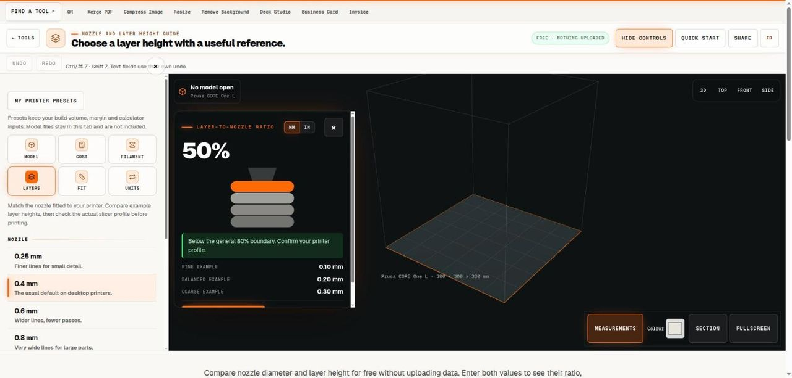

# Nozzle and Layer Height Guide

> Compare a proposed layer height with the nozzle diameter and profile guidance.

## What it does

Compare nozzle diameter and layer height for free without uploading data. Enter both values to see their ratio, three example heights and the general boundary below eighty percent of nozzle diameter. This is a planning guide, not a complete slicer profile. Confirm the printer and material profile, inspect the sliced preview and test the actual result.

## How to use it

1. Confirm the nozzle physically installed on the printer and the nozzle selected in the slicer profile. Enter its diameter in millimetres. Do not assume that the default profile changed automatically after a hardware nozzle replacement.
2. Enter the layer height you are considering. Read the ratio and the general upper boundary. The guide treats a value exactly at eighty percent as outside its below-boundary check, so choose and verify a suitable profile rather than aiming at the threshold.
3. Compare the fine, balanced and coarse examples, calculated at twenty-five, fifty and seventy-five percent of the nozzle diameter. They illustrate proportions; they are not certified settings for every printer, material or geometry.
4. Review the actual slicer profile, preview and a small representative print. Keep extrusion width, first-layer settings, speed and material flow requirements in view. Download the report to record the two entered values and the comparison you used.

## In this repository

- Route: `/tools/nozzle-layer-guide` and `/fr/tools/nozzle-layer-guide` (French). The page is `route.tsx` / `route.fr.tsx` in this folder.
- The editor is in [`../printing-tools/`](../printing-tools/), shared with: `filament-calculator`, `model-viewer`, `print-cost-calculator`, `tolerance-calculator`, `unit-converter`.
- Guide text: [`../../seo/content/nozzle-layer-guide.en.ts`](../../seo/content/nozzle-layer-guide.en.ts) and `nozzle-layer-guide.fr.ts`.

## Your files

The tool runs in the page. A file you open is read by the browser and processed on your device; the code in this repository has no upload path for it. `npm test` checks that every network call in the tools is on a short reviewed list (`tests/network-surface.test.mjs`).
