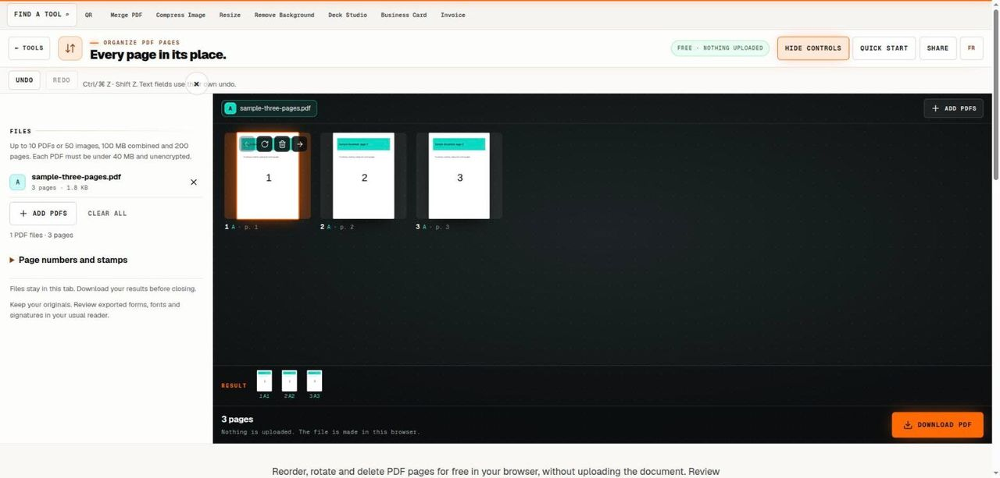

# Organize PDF Pages

> Correct the order and orientation of an existing PDF package.

## What it does

Reorder, rotate and delete PDF pages for free in your browser, without uploading the document. Review thumbnails, move pages with buttons or drag and drop, and use undo while arranging the list. Download a new PDF once the sequence is right. Your source remains unchanged, and the output still needs a final reader check.

## How to use it

1. Select the PDF files and review the page list from beginning to end. Identify the intended sequence before making changes. For scanned paperwork, compare page headings or other content rather than relying only on similar-looking thumbnails.
2. Move a page to its required place with drag and drop or the earlier and later buttons. Work in small groups, checking the transition on each side of the moved page. Keyboard users can use the same labelled controls.
3. Rotate sideways pages in quarter turns and remove unwanted pages individually. Use undo if a movement or deletion was mistaken. This changes complete pages; it does not crop away part of a scan or rearrange text inside a page.
4. Download the arranged PDF and reopen it in a reader. Confirm the page count, the reading direction and the start and end of each section. Retain the original until the saved output has been checked and accepted for its intended use.

## In this repository

- Route: `/tools/organize-pdf` and `/fr/tools/organize-pdf` (French). The page is `route.tsx` / `route.fr.tsx` in this folder.
- The editor is in [`../pdf-toolkit/`](../pdf-toolkit/), shared with: `images-to-pdf`, `jpg-to-pdf`, `merge-pdf`, `pdf-to-image`, `pdf-to-jpg`, `split-pdf`, `stamp-pdf`.
- Guide text: [`../../seo/content/organize-pdf.en.ts`](../../seo/content/organize-pdf.en.ts) and `organize-pdf.fr.ts`.

## Your files

The tool runs in the page. A file you open is read by the browser and processed on your device; the code in this repository has no upload path for it. `npm test` checks that every network call in the tools is on a short reviewed list (`tests/network-surface.test.mjs`).
