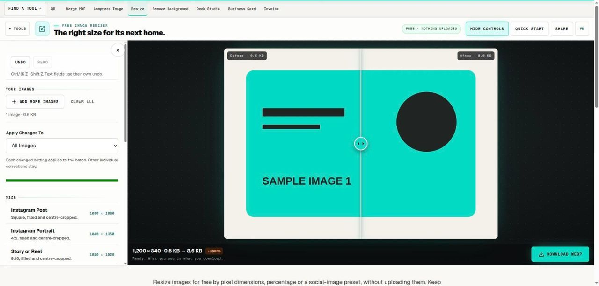

# Free Image Resizer

> Set pixel bounds or a percentage, with an explicit contain or cover choice.

## What it does

Resize images for free by pixel dimensions, percentage or a social-image preset, without uploading them. Keep the full image within a bounding box or fill the exact frame with a centre crop. Process several files locally, compare the resulting dimensions, and download individual images or a ZIP while preserving your originals.

## How to use it

1. Choose the original images and identify the destination’s required pixel dimensions. A platform’s upload limit and its displayed crop are separate constraints, so check both before choosing the size you want to create.
2. Select a pixel box or percentage. In pixel mode, contain keeps the full image within the requested bounds; cover fills the exact width and height by cropping from the centre. Use the crop tool for deliberate subject placement.
3. Choose an output format and run the batch. Inspect the reported dimensions for each file. Mixed portrait and landscape originals may produce different contained sizes even though they share the same bounding box.
4. Open the downloaded result at its intended display size. Check small text and important subjects, then preview it in the destination application. Save the original as a master rather than enlarging the resized copy for the next job.

## In this repository

- Route: `/tools/resize-image` and `/fr/tools/resize-image` (French). The page is `route.tsx` / `route.fr.tsx` in this folder.
- The editor is in [`../image-toolkit/`](../image-toolkit/), shared with: `compress-image`, `convert-image`, `crop-image`, `favicon-generator`, `heic-to-jpg`, `png-to-webp`, `remove-background`, `rounded-image`, `svg-to-png`.
- Guide text: [`../../seo/content/resize-image.en.ts`](../../seo/content/resize-image.en.ts) and `resize-image.fr.ts`.

## Your files

The tool runs in the page. A file you open is read by the browser and processed on your device; the code in this repository has no upload path for it. `npm test` checks that every network call in the tools is on a short reviewed list (`tests/network-surface.test.mjs`).
