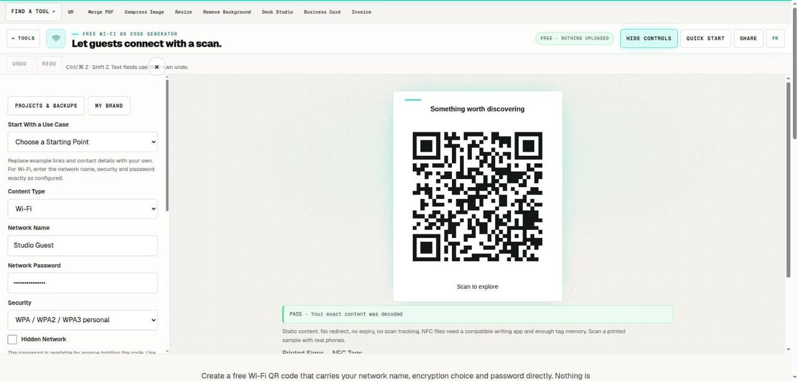

# Free Wi-Fi QR Code Generator

> Make a readable guest-network sign with the exact connection details.

## What it does

Create a free Wi-Fi QR code that carries your network name, encryption choice and password directly. Nothing is uploaded. Guests scan the printed code with a compatible phone to join the network. Start with a guest network, check the decoded credentials, then test a real phone before displaying the sign.

## How to use it

1. Enter the exact guest-network name, including capitals and spaces. Choose WPA, WEP or an open network to match the router.
2. Enter the password and mark the network hidden only if it is actually hidden. A QR code is readable data, so display it only where guests should receive access.
3. Keep the quiet border, wait for the scan check, and download a sign. Test joining on a phone that has not already saved the network.

## In this repository

- Route: `/tools/wifi-qr-code` and `/fr/tools/wifi-qr-code` (French). The page is `route.tsx` / `route.fr.tsx` in this folder.
- The editor is in [`../qr-code/`](../qr-code/), shared with: `calendar-qr-code`, `qr-code`, `vcard-qr-code`.
- Guide text: [`../../seo/content/wifi-qr-code.en.ts`](../../seo/content/wifi-qr-code.en.ts) and `wifi-qr-code.fr.ts`.

## Your files

The tool runs in the page. A file you open is read by the browser and processed on your device; the code in this repository has no upload path for it. `npm test` checks that every network call in the tools is on a short reviewed list (`tests/network-surface.test.mjs`).
